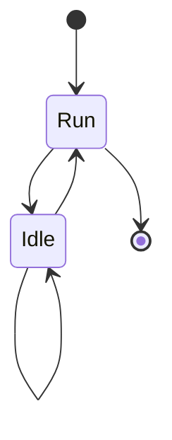

<div align="center">

# Finite State Machine — C++

**A compact implementation of the State pattern and finite-state-machine behavior.**


</div>

## Contents

- [Overview](#overview)
- [Concept](#concept)
- [Included states](#included-states)
- [Transition example](#transition-example)
- [Build](#build)
- [Repository layout](#repository-layout)
- [Design notes](#design-notes)
- [License](#license)

## Overview

This repository demonstrates a small C++ finite state machine (FSM). The example switches an object between state implementations, separating state-specific behavior from the code that owns the machine.

FSMs are useful for modeling character behavior, menus, workflow stages, device modes, and other systems with explicit states and transitions.

## Concept

A state machine typically consists of:

- A state abstraction defining the common interface
- Concrete state classes implementing individual behaviors
- A state-machine object that stores and changes the active state

## Included states

- `State/` — state abstraction
- `StateMachine/` — state coordination
- `IdleState/` — idle behavior example
- `RunState/` — running behavior example
- `main.cpp` — example that changes the active state

## Transition example



The diagram reflects the sequence of `setState()` calls in the current example program; it is not a complete gameplay state chart.

## Build

The repository includes a compilation helper:

```bash
chmod +x comp.sh
./comp.sh
```

Inspect `comp.sh` to see the compiler command and output path used by the project.

## Repository layout

```text
FSM/
├── State/
├── StateMachine/
├── IdleState/
├── RunState/
├── main.cpp
├── comp.sh
└── README.md
```

## Design notes

This is a learning implementation, not a versioned general-purpose FSM package. Before using it in a larger application, define ownership and lifetime rules for state objects, transition conditions, and error handling.

## License

This project is licensed under the **GNU General Public License v3.0 only (GPL-3.0-only)**. You may use, study, modify, and redistribute this project under the terms of the license.

See [LICENSE](LICENSE) for the complete license text. Third-party components and assets remain subject to their own licenses and notices.
